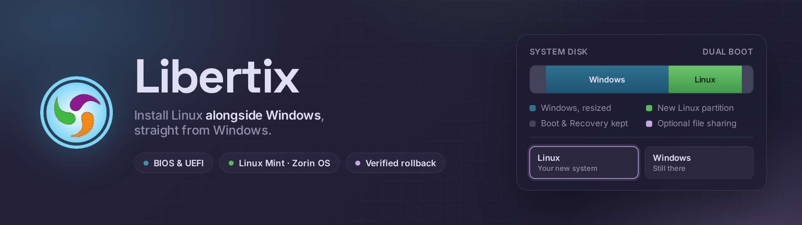
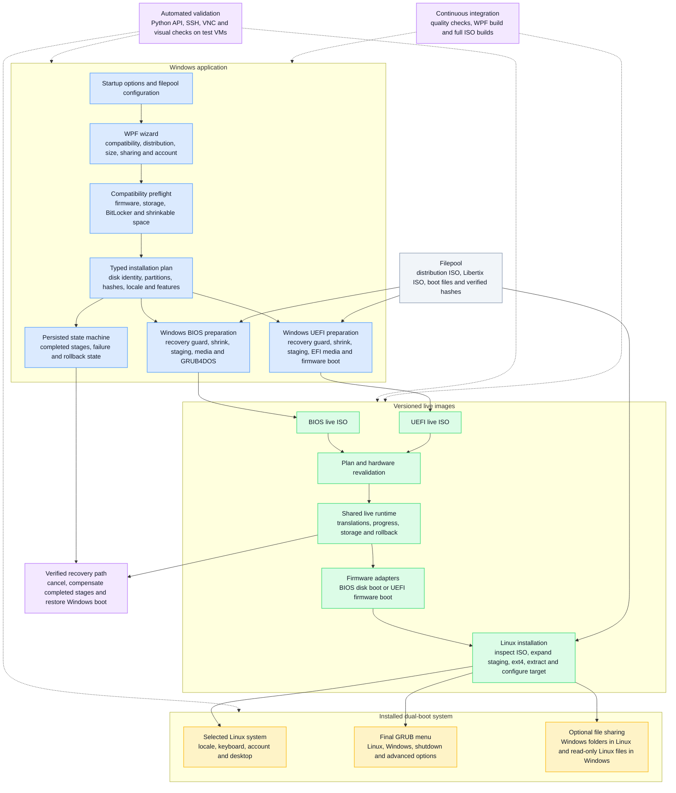

<p align="center">
  
</p>

<p align="center">
  <a href="https://github.com/ekimiateam/libertix/actions/workflows/ci.yml"></a>
  <a href="https://github.com/ekimiateam/libertix/releases/latest"></a>
  <a href="LICENSE"></a>
  
</p>

<p align="center">
  <a href="https://github.com/ekimiateam/libertix/releases/latest"><b>Download</b></a> ·
  <a href="#demo"><b>Demo</b></a> ·
  <a href="#getting-started"><b>Getting started</b></a> ·
  <a href="#technical-documentation"><b>Technical documentation</b></a> ·
  <a href="https://ekimia.fr/donations/campagne-libertix/"><b>Donate</b></a>
</p>

**Libertix** is a Windows application that installs a supported Debian/Ubuntu-family desktop system
alongside an existing Windows system. You choose a distribution, a size and an account in a simple
wizard; Libertix prepares Windows, boots a purpose-built live environment, installs Linux for you and
configures a dual-boot menu for either BIOS/MBR or UEFI/GPT machines. There is no USB stick to
prepare and no separate Linux installer to go through.

> [!WARNING]
> Libertix modifies disk partitions and boot configuration. Back up important data before using it.
> The compatibility checks deliberately reject layouts that cannot be handled safely.

## What Libertix does

- **Installs from Windows, without a USB stick.** The distribution is downloaded, verified with its
  SHA-256 hash and installed automatically after one reboot.
- **Keeps Windows and your data.** Windows is shrunk to make room for Linux; the Windows Recovery partition,
  OEM partitions and unrelated disks are preserved. Existing partitions are never moved.
- **Checks before it touches anything.** A compatibility preflight verifies firmware, storage layout,
  BitLocker and shrinkable space, and refuses machines it cannot handle safely.
- **Rolls back when something goes wrong.** Cancelling or a failure restores Windows and its boot
  configuration, then verifies the result. Linux can later be removed from the same application.
- **Verifies the installation.** After the first Linux boot, Windows cross-checks the result and shows
  a clear success or recovery screen.
- **Connects both systems if you want.** Optional file sharing exposes Windows folders in Linux and
  Linux files in Windows (read-only). An optional, opt-in migration copies selected Windows
  preferences and saved Wi-Fi networks to Linux.
- **Speaks your language.** English, French, Spanish and Korean, from the Windows wizard to the
  installed Linux system.
- **Works for install parties.** Distribution files can be shared from an adjacent folder or a local
  server, so several PCs do not each download the same ISO.

Supported distributions: **Linux Mint 22.3 Cinnamon** and **Zorin OS 18.1 Core**.

### New since 0.3 (development branch)

These changes are available in the `dev` branch and its prereleases, not yet in a stable release.

- **Korean** translation, in addition to English, French and Spanish.
- **Optional migration of Windows preferences** (wallpaper, theme, power and input settings) and
  saved personal Wi-Fi networks. It is opt-in and unchecked by default.
- **Experimental installation on a second internal disk**, with an explicit warning. The Windows
  system volume remains the recommended choice.
- **Verified Linux removal**: Libertix can remove the installed Linux system, restore the original
  Windows disk layout and boot configuration, and check the result.
- **Local file reuse** from a `filepool` folder next to `Libertix.exe` or from the install-party
  server, and reuse of an ISO left by an earlier failed run after its hash is verified.
- **Support reports**: error, compatibility and log screens can copy a report (known secrets and local
  identifiers are masked) and open the GitHub bug-report form. Nothing is sent automatically.
- **Safer startup**: Libertix repairs the permissions of its own directories and asks for confirmation
  when they look unsafe.
- **Secure Boot signer chains** are checked before a UEFI installation when Secure Boot is enabled.
- Automatic sleep and display timeout are prevented while Libertix is open, installation logs are
  exported more reliably after the first Linux boot, and developers get a verified cleanup tool for
  leftovers after a completed rollback.

## Demo

https://github.com/user-attachments/assets/d0b94e3b-0c9c-406e-9ee4-da1cb0888cdc

## How it works

1. **Prepare in Windows.** Run `Libertix.exe` as administrator. The wizard checks compatibility, then
   asks for the distribution, the Linux size, file sharing options and your Linux account. Libertix
   shrinks Windows, downloads and verifies the installation files and prepares a temporary boot.
2. **Install after one reboot.** A small Libertix live system starts, checks the plan and the hardware
   again, then installs and configures the selected distribution without further questions.
3. **Choose your system at boot.** The final boot menu offers Linux, Windows, shutdown and advanced
   options. Back in Windows, Libertix confirms that the installation was verified.

If a step fails or you cancel, the recovery path undoes only the operations that were completed and
verifies that Windows boots as before.

## Supported configuration

- Windows 10 or Windows 11, 64-bit
- BIOS with an MBR disk, or UEFI with a GPT disk
- .NET Framework 4.8
- Administrator privileges
- Linux Mint 22.3 Cinnamon or Zorin OS 18.1 Core
- Enough free space for at least 20 GiB of Linux, the installer media and the Windows free-space reserve
- At least 10 GiB reported shrinkable by Windows for initial preparation
- A storage layout accepted by the compatibility preflight

Libertix identifies the Windows system disk independently of unrelated attached storage. It supports
local SATA, ATA, NVMe, SAS, SCSI, or MMC system disks. It refuses ambiguous or
unsafe topologies such as Windows dynamic disks, Storage Spaces, USB system disks, VHD/iSCSI system
disks, unsupported RAID controllers and unsupported Intel RST/VMD or AMD RAID configurations.

The recommended destination takes space from the Windows system volume, usually `C:`. A compatible
NTFS volume on a distinct internal physical disk can also be selected, with an explicit experimental
support warning. Another drive letter on the same physical disk is not offered as an alternative.
Windows cannot reliably prove that every firmware will expose a secondary disk during boot.
Unrelated USB storage and OEM partitions are preserved. Existing partitions are not moved; layouts
requiring unsupported movement, ambiguous identities, or unavailable MBR partition slots are refused.

Free space and immediately shrinkable space are different. Libertix first tries to shrink Windows
by the full requested Linux size. If unmovable NTFS files prevent that, it can create an 8 GiB
temporary partition and finish the NTFS reduction from the live Linux environment. The initial
compatibility check requires 10 GiB shrinkable, including a 2 GiB safety margin; it does not require
the full Linux allocation to be shrinkable online. The temporary partition holds installation media
before becoming the final Linux partition. It is not sized only for the mini-ISO download.
The current free-space reserve is 8 GiB after accounting for installer media and Linux, with a
10 GiB target. The validated plan and storage checks remain authoritative for each machine.

BitLocker or Device Encryption must be fully decrypted before the live installer boots. Libertix
can request decryption and waits for it to finish. The detected Windows Recovery partition is kept
outside the Linux allocation and is checked again before the live environment writes to disk.

## Getting started

1. Back up your important files.
2. Download the latest stable `Libertix-<version>.zip` from the
   [releases page](https://github.com/ekimiateam/libertix/releases/latest) and extract
   `Libertix.exe`. Development prereleases are also published there for testing.
3. Plug in the power adapter on a laptop, then run `Libertix.exe` as administrator and follow the
   wizard.

To install several PCs without downloading the same files each time, put a `filepool` folder next to
`Libertix.exe` or use the local install-party server. See the
[setup and verification instructions](install-party-kit/README.md).

## Getting help

If an error appears, use **Copy support report** on the error or log screen, review the copied text,
then open the GitHub bug-report form with **Report an issue on GitHub** and paste it there. Libertix
never submits anything on your behalf. Remove anything you do not want to publish before posting.

### Live installer diagnostics

The temporary boot menu offers diagnostic entries for text mode, including a `nomodeset`
variant that avoids graphics-driver mode changes. These entries do not start installation.
Use Ctrl+Alt+F2 to open the diagnostic console. Early logs are saved on the temporary FAT
partition under `LibertixInstallLogs/Linux/<boot-id>/early`; runtime logs are in `/run/libertix`.
During a normal installation, an unresponsive graphical startup falls back to the text interface.

## Community and acknowledgements

Libertix is developed by Félix ([felix068](https://github.com/felix068)) and Ekimia, with
contributions from Michel Memeteau, MopigamesYT / Margot and Aamir Shahzad. Thank you to everyone
who has contributed code, tests, issue reports and documentation.

The project has also been made possible by its donors. Public supporters of the Libertix campaign
include **Olivier**, **Boyka**, **Coin des Geeks** and **Matthieu**. The campaign exceeded its
€3,000 goal through 41 donations. We are grateful to every donor, including those who chose to
remain anonymous.

To help fund continued development and testing, visit the
[Libertix donation campaign](https://ekimia.fr/donations/campagne-libertix/).

## Contributing

New to the codebase? [`CONTRIBUTING.md`](CONTRIBUTING.md) maps what each directory does and where
the core code lives.

Development takes place on the `dev` branch. Keep firmware-neutral behavior in the shared plan and
runtime modules, and limit BIOS/UEFI adapters to operations that genuinely differ. Changes to disk
or rollback behavior should include parity tests for both firmware paths and a replay of the
relevant failure scenario where possible.

The separate [development and auto-test guide](auto_tests/README.md) documents the locked `uv`
environment, Windows and mini-ISO builds, filepool, API, `curl` workflows, VM automation, and local
verification commands.

Read the project's position on AI-assisted development and contributions in the
[`AI_POLICY.md`](AI_POLICY.md) document.

---

## Technical documentation

The sections below describe how Libertix is built, configured and tested. They are intended for
contributors, testers and anyone who wants to understand what happens on their machine.

### Architecture overview

Libertix is split into three execution environments: the Windows application prepares the machine,
a small live system performs the Linux installation, and the installed system receives the final
boot and sharing configuration. BIOS and UEFI use separate boot adapters, while the safety rules,
installation plan, state tracking and most live operations are shared.

The authoritative lifecycle, state, and rollback guarantees are documented in
[`docs/ARCHITECTURE.md`](docs/ARCHITECTURE.md).



#### Main responsibilities

- `Libertix.exe` owns user interaction, compatibility checks and the initial Windows-side
  preparation. It produces one validated installation plan instead of letting each firmware path
  calculate its own disk values.
- `Installation/` contains the typed plan, size policy, validation and persisted state machine used
  to keep BIOS and UEFI behavior consistent.
- `Installation/InstallationEngine.Bios.cs` owns the complete Windows-side BIOS preparation: recovery guard,
  hibernation policy, shrink validation, FAT32 staging, live and distribution media, GRUB4DOS and
  the temporary BCD boot sequence.
- `Installation/InstallationEngine.Uefi.cs`, `Scripts/modules/` and `Scripts/uefi/` own the Windows-side UEFI
  preparation. The C# layer starts and observes the operation; the PowerShell modules implement
  staging, EFI media, firmware variables, transaction state and Windows-side rollback.
- `assets/live/` contains the shared live orchestrator and the small BIOS/UEFI adapters used after
  reboot. `iso/live/libertix-install.sh`, `iso/live/libertix-runner.sh` and their `iso-uefi/live/`
  counterparts are the actual image entry points; each is a thin wrapper that selects the firmware
  mode and executes the shared implementation.
- `iso/` and `iso-uefi/` contain the remaining firmware-specific boot inputs used to construct the
  two distinct live images.
- The recovery path reads the persisted state and compensates only operations that were completed;
  it then verifies the disk and boot state before reporting a successful rollback.
- The first installed-Linux boot publishes durable GRUB, firmware, filesystem, account and package
  evidence. Windows cross-checks it after reboot, removes only temporary artifacts, retains the
  rollback history, and displays a translated success or recovery result.
- `auto_tests/` builds and deploys the current working tree, controls the three authorized test VMs
  through SSH and VNC, and records visual and command-level evidence.

### Optional file sharing

The installer can expose Windows user folders in Linux and Linux user files in Windows. Linux files
are mounted read-only on Windows. Both directions are optional and selected before installation.
Windows folders are resolved from each registered profile, including redirected Documents and other
known folders on another supported internal NTFS volume. The installation records the volume and
disk identities, then rechecks them under Linux before creating the corresponding shortcuts.
Each Windows profile has one real `Win_<profile>` folder in the Linux home directory and one
file-manager bookmark. Inside it, shortcuts open that profile's Windows Desktop, Documents,
Downloads and other available known folders. Linux user folders and existing bookmarks are kept;
they are not redirected to Windows.
Unavailable, network, external, or separately encrypted data dependencies are not silently ignored
or decrypted. Disable Windows file sharing or resolve the reported dependency before installation.

When Windows preference migration is selected, Libertix starts the Windows WLAN AutoConfig service
if it is stopped and waits at most 30 seconds for it to run before reading saved Wi-Fi profiles.
Its startup type is not changed. A disabled service or a startup failure remains an explicit error.

### Runtime configuration

Libertix checks that untrusted accounts cannot modify or replace privileged code through its files
or parent directories. The interactive launcher and installer ask for explicit confirmation if
permissions are unsafe or cannot be evaluated; No is selected by default. Continuing accepts a
possible administrator-level code execution risk, does not change the permissions of `C:\`, and
does not disable file integrity checks. Consent lasts only for the interactive process. BootGuardian
and unattended privileged hosts keep their blocking permission checks.
Libertix reapplies its protected permissions to its own existing directories and their contents,
including those left by an older version. Potentially unsafe permissions require consent before
repair; repairing them does not establish that existing files are authentic.

To reuse files on several PCs, you can use either an **adjacent `filepool` folder without a server**
or the **local install-party server**. See the [setup and verification instructions](install-party-kit/README.md).
The folder is proposed first and remains supported independently of the server.

Without a command-line override, the executable selects a signed GitHub Pages channel from its
embedded build version:

```text
dev_<sha7>  -> https://ekimiateam.github.io/libertix/dev
0.3         -> https://ekimiateam.github.io/libertix/main
```

Reusing local ISO files does not remove the catalogue requirement. Libertix first downloads
`catalog.json` and its detached signature, verifies that signature, and only then looks beside
`Libertix.exe` for the exact filenames selected by the catalogue. A matching local file is used
after its SHA-256 is verified; otherwise Libertix downloads the artifact from the configured URL.
Stable builds also verify signed `releases.json` metadata and refuse to start when a newer stable
version has been published. Development builds deliberately skip only this freshness check; their
distribution catalogue remains signed.

Development builds and test runs can override it for one process without changing the production
default:

```powershell
.\Libertix.exe --filepool-base-url "http://127.0.0.1:8000/filepool"
```

The override is rejected by stable builds. In a development build it must be an absolute HTTP or
HTTPS URL without embedded credentials, query parameters or fragments. It is an explicit laboratory
mode, displays a permanent warning, and disables catalogue signature verification for that process;
it must not be used to trust an unverified third-party server.

Automated development installations also use an explicit static-address option:

```powershell
.\Libertix.exe --filepool-base-url "http://192.0.2.10:8000/filepool" `
  --dev-ssh-static-ip "192.0.2.50" `
  --dev-ssh-prefix-length 24 `
  --dev-ssh-gateway "192.0.2.1" `
  --dev-ssh-dns "9.9.9.9" `
  --dev-ssh-dns "1.1.1.1"
```

These development options are intentionally absent from production launches. They configure the
installed system with the supplied IPv4 profile, then install and enable password SSH for the Linux
account created by Libertix. The address, prefix, gateway and at least one DNS server form one
mandatory profile; providing only part of it is rejected. Repeat `--dev-ssh-dns` to configure more
than one resolver. Libertix rejects network, broadcast, loopback, multicast and link-local addresses,
prefixes outside `/1` through `/30`, and gateways outside the selected subnet.

On UEFI systems the compatibility preflight normally verifies firmware support by writing, reading
and restoring `BootNext` itself. Diagnostic environments that cannot permit this write can
explicitly use `--skip-nvram-write-probe`. The preflight records the probe as skipped and warns that
`BootNext` support is unproven; it never reports the skipped probe as successful. This option
reduces compatibility assurance and is not intended for normal installations.

### Build the Windows application

Libertix targets WPF on .NET Framework 4.8. A complete build requires Visual Studio 2022 Build Tools
with the managed desktop workload, the .NET Framework 4.8 SDK and the .NET Framework 4.8 targeting
pack.

From a Developer PowerShell prompt:

```powershell
msbuild .\Libertix.sln /restore /m /p:Configuration=Release "/p:Platform=Any CPU"
```

The internal WPF executable is written to `bin\Release\Libertix.exe`. The distributable, standalone
executable is `Standalone\bin\Release\Libertix.exe`; it bundles the required internal runtime.

### Build the live ISO images

The BIOS and UEFI ISO images are rebuilt completely from versioned sources with the Docker builder.
The process does not repack an existing ISO and does not require `sudo` on the host.

```bash
./iso-tools/build-isos-docker.sh all
```

Build a single firmware variant with `bios` or `uefi` instead of `all`. Successful builds produce:

```text
libertix-installer-bios.iso
libertix-installer-uefi.iso
```

The builder verifies the embedded scripts, schemas, boot configuration, theme and required runtime
tools before accepting either image.

Version, origin, license and SHA-256 information for binaries and fonts stored in the repository is
recorded in [THIRD_PARTY.md](THIRD_PARTY.md).

### Developer recovery cleanup

Developer-only cleanup after a verified rollback is documented in
[`maintenance/README.md`](maintenance/README.md). It is not an alternative to
rollback and refuses incomplete recovery evidence. Preview before any deletion.

### Tests

The automated test service is located in `auto_tests`. Its runtime configuration is loaded from a
local `.env` file; `auto_tests/.env.example` documents the required fields.
The complete developer environment, API reference, build workflow, and copy-paste Mint/Zorin
commands are documented in [`auto_tests/README.md`](auto_tests/README.md).

```bash
cd auto_tests
uv sync --frozen --extra dev
uv run --frozen python -m ruff check app tests tools ../assets/live/*.py ../iso-tools/*.py ../grub/*.py
uv run --frozen python -m ruff format --check app tests tools ../assets/live/*.py ../iso-tools/*.py ../grub/*.py
uv run --frozen python -m pytest --cov=app --cov-report=term-missing --cov-fail-under=70
```

The GitHub Actions workflow also validates Shell syntax, runs ShellCheck, analyzes PowerShell with
PSScriptAnalyzer, runs the Pester contract suite, builds `Libertix.exe` on Windows and builds both
ISO images on trusted `dev` and `main` branch runs. Successful runs publish the WPF archive, both ISO
images in a GitHub Release. The CI then generates and signs one artifact and distribution catalogue
and publishes it, its detached signature, and the verified support files only in the corresponding
`dev/` or `main/` directory on GitHub Pages. The versioned Windows ZIP contains exactly one
standalone `Libertix.exe`. Build identity is embedded in the executable; licensing and third-party
notices are documented in this repository.

The complete versioning, signing, release and Pages workflow is documented in
[`docs/RELEASES.md`](docs/RELEASES.md).

### Source layout

- `Installation/` — typed installation plan, validation, size policy and persisted state machine
- `Installation/InstallationEngine*.cs` — Windows orchestration, including the complete BIOS
  preparation and the C# control layer for the PowerShell UEFI workflow; it has no WPF dependency
- `Pages/ApplyChanges.xaml.cs` — installation progress screen that renders the engine's log and
  progress and forwards cancel, retry and restart decisions
- `Scripts/modules/` — shared PowerShell plan, state, download, storage and rollback functions
- `Scripts/uefi/` — operations that are specific to UEFI preparation
- `assets/live/` — shared live installer, runner, target configuration and firmware adapters
- `iso/` and `iso-uefi/` — firmware-specific boot inputs and thin live entry wrappers
- `schemas/` — versioned JSON contracts for the plan and execution state
- `auto_tests/` — API, VM automation, visual checks and regression tests

Additional UEFI boot details are documented in
[`docs/UEFI_BOOTNEXT_BOOTORDER.md`](docs/UEFI_BOOTNEXT_BOOTORDER.md).

## License

Libertix is distributed under the GNU General Public License v3.0. See [`LICENSE`](LICENSE).

## Acknowledgments

- [Rose Pine](https://rosepinetheme.com/) for the application color palette
- [WPF](https://github.com/dotnet/wpf) for the Windows desktop framework
